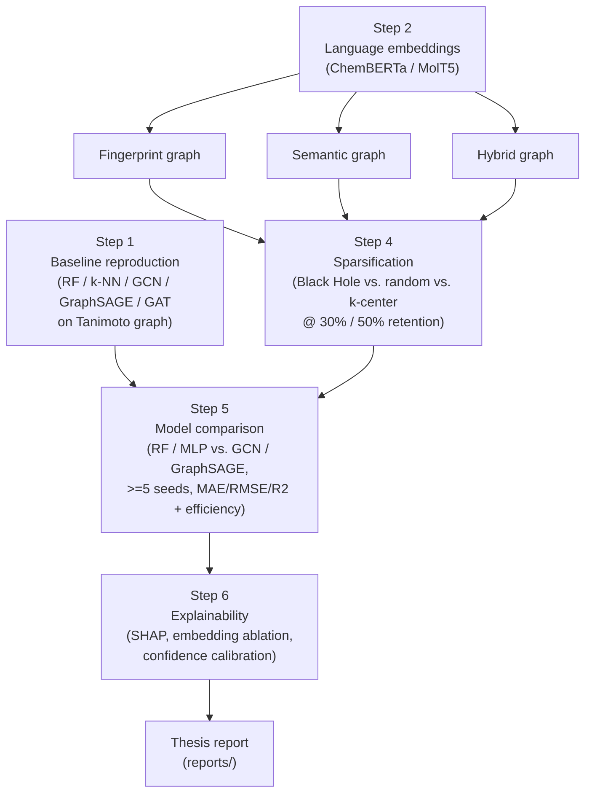

# MOFSemNet

Master's thesis project extending a prior Case Study (**MOFQuantumNet**) that predicted
Metal-Organic Framework Pore Limiting Diameter (PLD) using a fingerprint-similarity graph + GNN.
That prior work found non-graph baselines (Random Forest, k-NN) beat every GNN configuration,
because the similarity graph was built from information already present in each node's own
features — the graph added no genuinely new signal.

This thesis tests two questions on the same 14,296-MOF dataset:

1. Does a similarity graph built from a **different** kind of information — embeddings from a
   pretrained chemical language model (ChemBERTa / MolT5) over linker SMILES — finally give a
   GNN a genuine edge over non-graph baselines?
2. Does **Black Hole sparsification** (gravity-based graph pruning, reused from the prior work)
   still preserve accuracy on these new graph types, compared to random and k-center sampling
   baselines?

## Pipeline



(Source: `docs/architecture.mmd`, regenerated with `python scripts/generate_architecture_diagram.py`.)

## Scope guardrails

- **One dataset**: the large, 14,296-MOF set (`data/raw/MOFCSD.csv`). Fixed train/val/test
  splits; the test set is never touched until final evaluation.
- **One target**: continuous PLD. Never used as an input feature anywhere downstream.
- **Two pretrained language models wired in** (ChemBERTa, MolT5) so they can be compared against
  each other, but any single run embeds with exactly one, chosen via config.
- **At most two GNN architectures** (GCN, GraphSAGE) and **two retention levels** (30%, 50%).
- No literature mining, generative design, data augmentation, or additional target properties.

## Tech stack

| Concern | Library |
|---|---|
| Deep learning / GNNs | PyTorch, PyTorch Geometric |
| Pretrained language models | Hugging Face `transformers` (ChemBERTa, MolT5) |
| Classical ML, k-center | scikit-learn |
| Cheminformatics | RDKit |
| Graph construction / community detection | NetworkX |
| Explainability | SHAP |
| Testing | pytest |

## Folder structure

```
src/
  baseline/            Step 1 — ported as-is from the prior Case Study repo (data ingestion,
                        feature engineering, fingerprint graph, Black Hole sparsification,
                        GCN/GraphSAGE/GAT training loop, RF/k-NN baselines).
  common/               Central config (RuntimeConfig), device resolution, shared logging,
                        exceptions — everything Steps 2-6 read from instead of hardcoding.
  language/             Step 2 — ChemBERTa/MolT5 embedders, disk-cached embedding factory,
                        separate metal one-hot representation.
  graphs/                Step 3 — fingerprint / semantic / hybrid graph builders.
  sparsification_baselines/  Step 4's comparison points — random and k-center sampling
                        (Black Hole itself lives in src/baseline/, reused unmodified).
  evaluation/            Step 5 — seed aggregation, efficiency tracking, the full
                        RF/MLP/GCN/GraphSAGE x graph type x sparsification x retention sweep.
  models/                Non-graph baselines that aren't part of the Step 1 port (MLP).
  explainability/        Step 6 — SHAP, embedding ablation, confidence calibration. Stubbed
                        (raise NotImplementedError) until Step 5 has trained models to explain.
tests/                   Mirrors src/. tests/baseline/ was ported alongside its source; every
                        other directory has real tests where the module is testable offline,
                        network-gated tests for the two pretrained models, and stub tests
                        documenting Step 6's current NotImplementedError contract.
scripts/                 One runnable entry point per step (run_step1_baseline.py ...
                        run_step6_explainability.py), plus generate_architecture_diagram.py.
notebooks/               colab_setup.ipynb — Colab-only setup (Drive mount, dependency install),
                        kept out of src/ so core library code stays platform-agnostic.
data/
  raw/                  Input data (MOFCSD.csv).
  processed/             Cached graphs (Step 3/4 output).
  embeddings/            Cached language-model embeddings (Step 2 output).
outputs/
  logs/                  Per-module log files (src.common.logging_setup).
  figures/, results/, models/   Generated plots, comparison tables, checkpoints.
papers/                  Literature review PDFs + a short notes file per paper (see
                        papers/README.md) — kept for traceable citations.
reports/
  logs/                  Dated progress-log entries, one per work session (see reports/README.md)
                        — the raw material the final thesis report gets written from.
docs/                    Generated architecture diagram source (architecture.mmd), plus
                        ADDING_CONTENT.md and DEPLOYMENT.md for the web console below.

content/                 YAML content for the web console — architecture.yaml, papers.yaml,
                        plan.yaml, progress.yaml, results/step{1..4}.yaml. See "Web console".
backend/                 FastAPI app serving the web console's API. See "Web console".
frontend/                React/TypeScript web console UI. See "Web console".
Dockerfile.webapp        Builds the web console (separate from the root Dockerfile, which
                        packages the ML pipeline/test environment — see "Web console").
docker-compose.yml       `docker compose up -d --build` runs the web console.
```

## Setup

### Local (personal machine / university server)

```bash
python -m venv .venv
source .venv/bin/activate         # .venv\Scripts\activate on Windows
pip install -r requirements.txt -r requirements-dev.txt
pip install -e .                  # editable install, so `from src...` imports resolve anywhere
```

### Docker

```bash
docker build -t mofsemnet .
docker run --rm -v "$(pwd)/data:/app/data" -v "$(pwd)/outputs:/app/outputs" mofsemnet
```

Data and outputs are mounted as volumes rather than baked into the image (see `.dockerignore`),
so the same image works across machines without rebuilding whenever the dataset changes.

### Google Colab

Open `notebooks/colab_setup.ipynb` first — it mounts Drive, clones/pulls the repo, and installs
dependencies while leaving Colab's preinstalled (usually CUDA-enabled) torch build alone. See
[Device configuration](#device-configuration) for why nothing else in this repo needs a
Colab-specific code path.

## Device configuration

Every module that needs a `torch.device` calls `src.common.runtime.get_device(config)` instead
of resolving CUDA/CPU inline. `RuntimeConfig.device` (in `src/common/config.py`) controls it:

- `"auto"` (default) — CUDA if available, then Apple Silicon MPS, then CPU. This is what makes
  the same code run unmodified on a personal GPU box, Colab, a university server, or a laptop.
- `"cpu"` / `"cuda"` / `"mps"` — force a specific backend; requesting one that isn't available
  raises rather than silently falling back, so a broken CUDA/MPS setup is never masked.

`src/baseline/` (the Step 1 port) resolves its own device inline, unchanged from the source
repo — `get_device` is only used by the new Steps 2-6 modules.

## Running the 6 steps

Each script is a thin CLI wrapper; all logic lives in `src/`.

```bash
python scripts/run_step1_baseline.py                          # Step 1: reproduce the baseline
python scripts/run_step2_language_embeddings.py --model chemberta
python scripts/run_step3_build_graphs.py --model chemberta     # needs Step 2's cache
python scripts/run_step4_sparsification.py --model chemberta --graph-type semantic
python scripts/run_step5_comparison.py --model chemberta       # the full RF/MLP/GCN/GraphSAGE sweep
python scripts/run_step6_explainability.py                     # raises until Step 5 has trained models
```

Swap `--model chemberta` for `--model molt5` to compare language representations directly (both
are wired into `src/common/config.py`'s `LANGUAGE_MODEL_CHOICES`, since one goal of this thesis
is comparing them, not just picking one upfront).

## Testing

```bash
pytest                    # fast: skips network-gated (pretrained model download) tests
pytest --run-network       # also exercises real ChemBERTa/MolT5 forward passes
pytest -m slow             # only the end-to-end Step 5 orchestration test
```

`tests/` mirrors `src/` directory-for-directory. `tests/baseline/` was ported alongside its
source and includes a reconstructed `conftest.py` (the original fixture file wasn't part of what
was copied in) providing `small_df`, `large_df`, and `tiny_graph` fixtures used across that
suite.

## Config

`src/common/config.py`'s `RuntimeConfig` is the single place every run-time-tunable value lives:
dataset path, random seeds (>=5, enforced), retention levels (0.3/0.5), which language model,
device, gravity weights, cache/output directories. Scripts construct a `RuntimeConfig` and pass
it through rather than hardcoding values inline.

`src/baseline/config.py` (Step 1, ported as-is) keeps its own separate dataset/task switches —
intentionally untouched, since it predates and is independent of the new work's config.

## Web console

A permanent, extensible progress/architecture console for supervisor meetings — not a one-off
presentation, meant to be extended month over month as the thesis progresses. FastAPI backend +
React/TypeScript frontend, both under `backend/` and `frontend/`, reading from a single source of
content: `content/*.yaml`.

```
content/
  architecture.yaml      Nodes/edges for the interactive pipeline explorer — the one file to
                          edit to add a new stage, graph type, or comparison method.
  papers.yaml             Literature, clustered, cross-linked to architecture nodes.
  plan.yaml                Research questions and scope guardrails.
  progress.yaml            Work-package status and milestones (mirrors the expose's Gantt chart).
  results/step{1..4}.yaml  Real, precomputed results per step. Never invented — a step with no
                          results.yaml file 404s on /api/results/<id> rather than showing a
                          placeholder number.
backend/app/
  core/config.py           Env-based settings (content dir, CORS, demo model) — see
                          backend/.env.example.
  models/schemas.py        Pydantic models mirroring content/*.yaml exactly.
  services/content_loader.py  Loads + validates content/*.yaml at startup; a typo'd reference
                          (e.g. a node citing a paper id that doesn't exist) fails loudly here,
                          not silently in the browser.
  services/embedding_service.py  Backs the one live demo (/implemented): embeds a submitted
                          SMILES with the real ChemBERTa model, finds its nearest neighbours
                          among the real cached embeddings for all 14,296 MOFs.
  api/routes_*.py          One file per resource (architecture, papers, plan, progress,
                          results, predict, content-reload).
frontend/src/
  pages/                    One file per section (Plan, Architecture, Implemented, Studied,
                          References, Progress) — matches the nav exactly.
  components/architecture/  The React Flow explorer: dagre auto-layout from
                          content/architecture.yaml, hover-to-highlight-connections,
                          click-to-open detail panel.
  api/client.ts             Typed fetch wrappers, one per backend endpoint.
  types/content.ts          TypeScript types mirroring backend/app/models/schemas.py.
```

**Adding a new pipeline stage, graph type, or comparison method**: edit `content/architecture.yaml`
only — add a node and its edges. The diagram relayouts itself (dagre), no component code changes.
See `docs/ADDING_CONTENT.md` for the full walkthrough (new architecture node, new paper, new
result, new page).

### Running it locally

All commands below assume you're at the **repo root** (`MOFSemNet/`), not already inside
`backend/` or `frontend/` — `cd` there first if a shell from an earlier session left you deeper
in the tree.

```bash
# Terminal 1 — backend, from the repo root
pip install -r requirements.txt -r backend/requirements.txt
uvicorn app.main:app --reload --app-dir backend --port 8010

# Terminal 2 — frontend (hot-reload dev server, proxies /api to :8010), from the repo root
cd frontend
npm install
npm run dev
```

Open `http://localhost:5173`.

### Deploying

```bash
docker compose up -d --build
```

The `-d` runs it **detached** — it keeps running in the background and gives you your terminal
back immediately. Without `-d`, `docker compose up` stays attached and streams logs until you
press Ctrl+C, which also stops the container (that's expected behavior, not a crash, if you see
it shut down right after you hit Ctrl+C).

```bash
docker compose logs -f     # tail logs for a detached run
docker compose down        # stop and remove the container
```

Single container, one process, port 8000 — `Dockerfile.webapp` builds the React app and serves
it from the same FastAPI process that serves the API (`backend/app/main.py` mounts
`frontend/dist` as static files when present), matching the prior Case Study web console's
"one process, one URL" design. `data/`, `outputs/`, and `content/` are mounted as volumes, not
baked into the image, so updating a result or adding an architecture node doesn't require a
rebuild — restart the container (or hit `POST /api/content/reload` for `content/*.yaml` changes
specifically).

This is separate from the root `Dockerfile`, which packages the ML pipeline/test environment —
the two don't conflict and serve different purposes.

See `docs/DEPLOYMENT.md` for university-server deployment notes (reverse proxy, env vars, moving
the embedding model's GPU/CPU choice).
