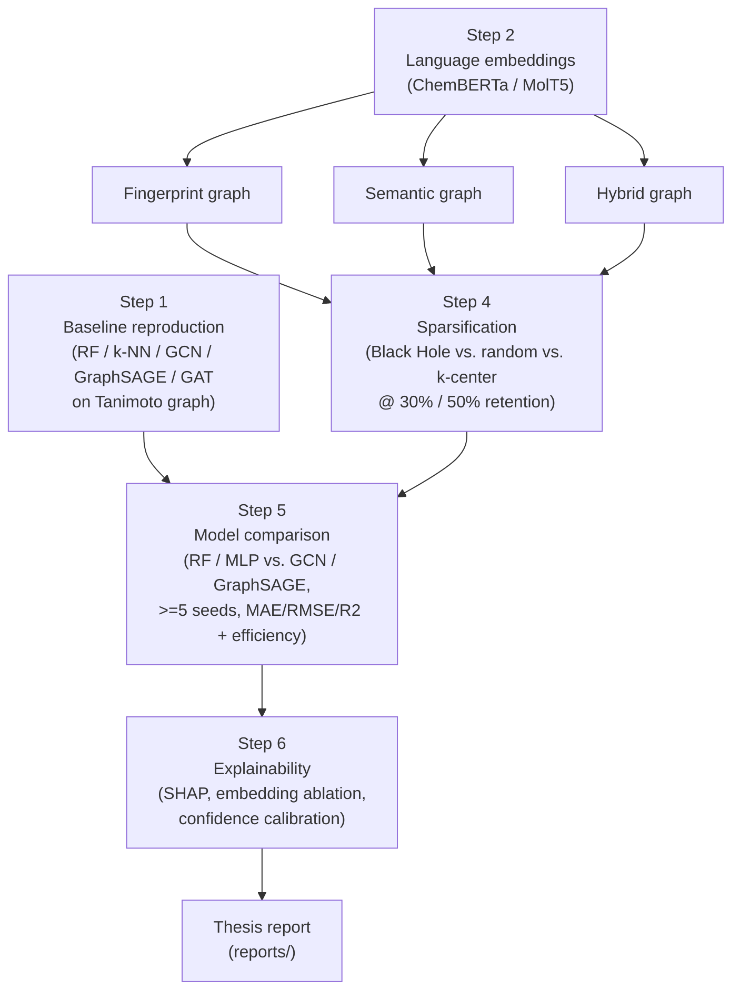

# MOFSemNet

**Language-Model-Enriched Graph Learning with Black Hole Sparsification for Metal-Organic Framework Property Prediction**
(Master's thesis, Gowrika Mahesh; supervisor Prof. Mehrdad Jalali)

Master's thesis project that predicts the Pore Limiting Diameter (PLD) of Metal-Organic Frameworks as a continuous
value (regression). Earlier research on the same data (**MOFQuantumNet**, a reproduction of MOFGalaxyNet, which also covered
classification) used a fingerprint-similarity graph + GNN and found that non-graph baselines (Random Forest, k-NN) beat every
GNN configuration, because the similarity graph was built from information already present in each node's own features.

This thesis tests two questions on the same 14,296-MOF dataset:

1. Does a similarity graph built from a **different** kind of information — embeddings from a
   pretrained chemical language model (ChemBERTa / MolT5) over linker SMILES — finally give a
   GNN a genuine edge over non-graph baselines?
2. Does **Black Hole sparsification** (gravity-based graph pruning, reused from the prior work)
   still preserve accuracy on these new graph types, compared to random and k-center sampling
   baselines?

## Pipeline



(Source: `docs/architecture.mmd`, regenerated with `python scripts/generate_architecture_diagram.py`.)

## Scope guardrails

- **One dataset**: the large, 14,296-MOF set (`data/raw/MOFCSD.csv`). Fixed train/val/test
  splits; the test set is never touched until final evaluation.
- **One target**: continuous PLD. Never used as an input feature anywhere downstream.
- **Two pretrained language models wired in** (ChemBERTa, MolT5) so they can be compared against
  each other, but any single run embeds with exactly one, chosen via config.
- **At most two GNN architectures** (GCN, GraphSAGE) and **two retention levels** (30%, 50%).
- No literature mining, generative design, data augmentation, or additional target properties.

## Tech stack

| Concern | Library |
|---|---|
| Deep learning / GNNs | PyTorch, PyTorch Geometric |
| Pretrained language models | Hugging Face `transformers` (ChemBERTa, MolT5) |
| Classical ML, k-center | scikit-learn |
| Cheminformatics | RDKit |
| Graph construction / community detection | NetworkX |
| Explainability | SHAP |
| Testing | pytest |

## Folder structure

```
src/
  baseline/            Step 1 — ported as-is from the earlier research repo (data ingestion,
                        feature engineering, fingerprint graph, Black Hole sparsification,
                        GCN/GraphSAGE/GAT training loop, RF/k-NN baselines).
  common/               Central config (RuntimeConfig), device resolution, shared logging,
                        exceptions — everything Steps 2-6 read from instead of hardcoding —
                        plus structure_svg.py (RDKit linker drawings for the web console).
  language/             Step 2 — ChemBERTa/MolT5 embedders, disk-cached embedding factory,
                        separate metal one-hot representation.
  graphs/                Step 3 — fingerprint / semantic / hybrid graph builders.
  sparsification_baselines/  Step 4's comparison points — random and k-center sampling
                        (Black Hole itself lives in src/baseline/, reused unmodified).
  evaluation/            Step 5 — seed aggregation, efficiency tracking, the full
                        RF/MLP/GCN/GraphSAGE x graph type x sparsification x retention sweep.
  models/                Non-graph baselines that aren't part of the Step 1 port (MLP), plus
                        gnn_residual.py (residual GCN used in the Step 5b diagnostics).
  explainability/        Step 6 — SHAP (with an additivity check), embedding ablation, split-conformal
                        confidence intervals, fragment mapping of fingerprint bits, and explainers for
                        XGBoost / GNNs (model_explainers.py: SHAP, GNNExplainer, LIME).
  demo/                  predictor.py (MOFPredictor) — predicts the PLD of a new linker + metal with the saved
                        models; used by scripts/predict_mof.py and the Live Demo endpoint.
tests/                   Mirrors src/. tests/baseline/ was ported alongside its source; every
                        other directory has real tests where the module is testable offline,
                        and network-gated tests for the two pretrained models.
scripts/                 One runnable entry point per step (run_step1_baseline.py ...
                        run_step6_explainability.py, run_step6b_explainers.py,
                        run_step6c_gnn_explainers.py, run_step6d_embedding_shap.py), results export / comparison scripts
                        (export_traceable_results.py, build_mofgalaxynet_comparison.py), plus
                        generate_architecture_diagram.py and
                        export_graph_comparison.py (data for the web console's network view),
                        predict_mof.py, export_model_predictions.py, evaluate_new_mof_predictions.py
                        run_demo.sh (starts the web app with the Live Demo) and export_graph_sample.py
                        (the real 140-MOF graph piece behind the Explorer's hover view).
notebooks/               colab_setup.ipynb — Colab-only setup (Drive mount, dependency install),
                        kept out of src/ so core library code stays platform-agnostic.
data/
  raw/                  Input data (MOFCSD.csv).
  processed/             Cached graphs (Step 3/4 output).
  embeddings/            Cached language-model embeddings (Step 2 output).
outputs/
  logs/                  Per-module log files (src.common.logging_setup).
  figures/, results/, models/   Generated plots, comparison tables, checkpoints (git-ignored).
results/                 Tracked copy of the result CSVs with MANIFEST.csv (script, configuration, data
                        version, seeds per file) and its own README — see results/README.md.
papers/                  Literature review PDFs + a short notes file per paper (see
                        papers/README.md) — kept for traceable citations.
reports/
  logs/                  Dated progress-log entries, one per work session (see reports/README.md)
                        — the raw material the final thesis report gets written from.
docs/                    Generated architecture diagram source (architecture.mmd), ADDING_CONTENT.md and
                        DEPLOYMENT.md for the web console below, THESIS_PROGRESS_SUMMARY.md/.pdf and
                        ui_mockup/ (the design the new UI follows).

content/                 Content for the web console — architecture.yaml, papers.yaml,
                        plan.yaml, progress.yaml, results/step{1..6}.yaml, and the generated
                        graph_comparison_<model>.json. See "Web console".
backend/                 FastAPI app serving the web console's API. See "Web console".
frontend/                Web app: public/mofworld.html (landing page, Live Demo, Research Explorer).
                        See "Web console".
Dockerfile.webapp        Builds the web console (separate from the root Dockerfile, which
                        packages the ML pipeline/test environment — see "Web console").
docker-compose.yml       `docker compose up -d --build` runs the web console.
```

## Setup

### Local (personal machine / university server)

```bash
python -m venv .venv
source .venv/bin/activate         # .venv\Scripts\activate on Windows
pip install -r requirements.txt -r requirements-dev.txt
pip install -e .                  # editable install, so `from src...` imports resolve anywhere
```

### Docker

```bash
docker build -t mofsemnet .
docker run --rm -v "$(pwd)/data:/app/data" -v "$(pwd)/outputs:/app/outputs" mofsemnet
```

Data and outputs are mounted as volumes rather than baked into the image (see `.dockerignore`),
so the same image works across machines without rebuilding whenever the dataset changes.

### Google Colab

Open `notebooks/colab_setup.ipynb` first — it mounts Drive, clones/pulls the repo, and installs
dependencies while leaving Colab's preinstalled (usually CUDA-enabled) torch build alone. See
[Device configuration](#device-configuration) for why nothing else in this repo needs a
Colab-specific code path.

## Device configuration

Every module that needs a `torch.device` calls `src.common.runtime.get_device(config)` instead
of resolving CUDA/CPU inline. `RuntimeConfig.device` (in `src/common/config.py`) controls it:

- `"auto"` (default) — CUDA if available, then Apple Silicon MPS, then CPU. This is what makes
  the same code run unmodified on a personal GPU box, Colab, a university server, or a laptop.
- `"cpu"` / `"cuda"` / `"mps"` — force a specific backend; requesting one that isn't available
  raises rather than silently falling back, so a broken CUDA/MPS setup is never masked.

`src/baseline/` (the Step 1 port) resolves its own device inline, unchanged from the source
repo — `get_device` is only used by the new Steps 2-6 modules.

## Running the 6 steps

Each script is a thin CLI wrapper; all logic lives in `src/`.

```bash
python scripts/run_step1_baseline.py                          # Step 1: reproduce the baseline
python scripts/run_step2_language_embeddings.py --model chemberta
python scripts/run_step3_build_graphs.py --model chemberta     # needs Step 2's cache
python scripts/run_step4_sparsification.py --model chemberta --graph-type semantic
python scripts/run_step5_comparison.py --model chemberta       # the full RF/MLP/GCN/GraphSAGE sweep
PYTHONPATH=. python scripts/run_step6_explainability.py --model chemberta [--test-set hubs]   # SHAP, column groups, ablation, conformal intervals
PYTHONPATH=. python scripts/run_step6b_explainers.py            # Step 6b: SHAP for XGBoost + no-edge GCN, GNNExplainer, LIME
PYTHONPATH=. python scripts/run_step6c_gnn_explainers.py        # Step 6c: SHAP + LIME for GNNs with a graph (3 seeds, baseline graph + semantic)
PYTHONPATH=. python scripts/run_step6d_embedding_shap.py        # Step 6d: SHAP on the embedding dimensions vs RDKit descriptors
PYTHONPATH=. python scripts/export_traceable_results.py         # copy result CSVs into results/ + MANIFEST.csv
PYTHONPATH=. python scripts/run_step5b_ablations.py --model chemberta   # Step 5b: no-edge GNN, baseline graph, small k,
                                                               # ChemBERTa as input, residual GNN (5 seeds)
```

After Step 3, regenerate the web console's fingerprint-vs-semantic network data (reads the cached
graphs; run once per language model):

```bash
PYTHONPATH=. python scripts/export_graph_comparison.py --model chemberta
PYTHONPATH=. python scripts/export_graph_comparison.py --model molt5
```

Swap `--model chemberta` for `--model molt5` to compare language representations directly (both
are wired into `src/common/config.py`'s `LANGUAGE_MODEL_CHOICES`, since one goal of this thesis
is comparing them, not just picking one upfront).

## Results so far

All numbers are test-set R² (mean of seeds 0-4) on the 14,296-MOF dataset unless stated otherwise (the Step 6
explainer shares are on the 2,144-MOF random test set: the tree and no-edge SHAP numbers use the seed-0 split, the GNN-with-graph explainers
use seeds 0-2 and 30 test MOFs). "Net" SHAP share means each input group's net contribution per MOF; the summed-column share
adds each column's mean |SHAP| separately and inflates the 1,024-column fingerprint group. Per-run CSVs sit in
`outputs/results/` (tracked copies and a manifest in `results/`); the dated entries in `reports/logs/` explain each run.

| Finding | Evidence |
|---|---|
| The baseline Random Forest on fingerprints is the strongest simple model | R² 0.883 (random test set), 0.888 (hub test set), in line with the earlier research (see below) |
| Tuning the Random Forest does improve it (validation-only search, data unchanged) | `max_features=0.3` (each split looks at 30% of the columns), chosen on the validation split, 300 trees: R² 0.8947 (random test set) vs 0.8825 default (+0.012, better in 5 of 5 seeds) and 0.8998 (hub test set, 664 MOFs) vs 0.8906 (+0.009, 5 of 5); also trained on training + validation: 0.8982 / 0.9029. ExtraTrees with default settings: 0.8935 / 0.9016. Script `scripts/tune_random_forest.py` |
| Tuned GNNs: still no graph beats the same GNN with no edges (`scripts/tune_gnns.py`) | settings chosen on the validation split only, tested with the old defaults alongside, seeds 0-4, R² random / hub: no edges — GCN 0.8779 / 0.8692, GraphSAGE 0.8796 / 0.8741, residual GCN 0.8816 / 0.8725; baseline graph k=3 — GCN 0.6381 / 0.4100, GraphSAGE 0.8760 / 0.8609, residual GCN 0.8790 / 0.8680, APPNP 0.7392 / 0.6078, GAT 0.6100 / 0.5846, SGC 0.6185 / 0.4323, GIN 0.5629 / 0.0929; baseline graph + Black Hole 30% — GCN 0.7166 / 0.6920, GraphSAGE 0.8637 / 0.8485, residual GCN 0.8779 / 0.8658. Tuning adds +0.002 to +0.022 (no-edge GNN 0.874 -> 0.882). The earlier exception (residual GCN + Black Hole on the hub set) disappears once the no-edge model is tuned too. Gap to the best tree model (ExtraTrees 0.8998 / 0.9044) is 0.018 / 0.030 |
| ExtraTrees (tuned) is the best single model so far; boosted trees, a Tanimoto-kernel regressor and Ridge are not better (`scripts/run_model_zoo.py`) | settings chosen on the validation split only, seeds 0-4, original data and target. R² random / hub (664 MOFs): ExtraTrees 0.8998 / 0.9044, tuned Random Forest 0.8950 / 0.8993, XGBoost 0.8972 / 0.8499, CatBoost 0.8954 / 0.8514, LightGBM 0.8924 / 0.8760, HistGradientBoosting 0.8843 / 0.8630, Tanimoto-kernel 0.7582 / 0.8317, Ridge 0.8071 / 0.7890. ExtraTrees beats the tuned forest by +0.005 in 5 of 5 seeds on both test sets. Averaging the 3 best on validation: 0.9042 / 0.9003 (a gain only on the random set). ExtraTrees MAE / RMSE 0.458 / 0.946 |
| Gradient boosting is not a consistent improvement | XGBoost 0.893 vs Random Forest 0.883 on the random test set (+0.010, above seed spread), 0.877 vs 0.888 on the hub set; LightGBM never clearly better; best single scores 0.897 (LightGBM, random) and 0.905 (Random Forest with RDKit descriptors, hub) |
| GNN training was under-trained, and is fixed | the old runs always used all 200 epochs (target scale); z-scoring the target and continuous inputs lifts the no-edge GNN from 0.84 to 0.874 (random test set) and removes the log-target collapse (0.863). Longer training or a smaller learning rate added nothing |
| A GNN with **no edges** is as good as any GNN with a graph | with the fix: no edges 0.874; full baseline graph 0.64-0.66 (GCN / GraphSAGE), fingerprint graph 0.59-0.60; residual GCN with a graph equals its no-edge version (0.873 vs 0.875). One exception: residual GCN + Black Hole 30% on the hub test set, +0.009 (bias caveat); on the random set -0.008 |
| Fewer neighbours are better | baseline graph, GCN: k=3 0.622, k=5 0.575, k=10 0.527 |
| Without the pore columns (LCD, LFS) R² falls to about 0.6, and the graph still adds nothing | best tree 0.613 (random) / 0.651 (hub); best graph GNN 0.594 / 0.588; every graph vs no-edge comparison is zero or negative |
| New descriptors help only a little | RDKit linker descriptors add +0.01 to +0.03 R² to tree models without LCD/LFS and nothing with them; metal descriptors, count fingerprints, MACCS and all RDKit descriptors add nothing reliable |
| Linker-level de-duplicated, descriptor-space graphs and graph-smoothed features do not help | all graph variants stay below the no-edge GNN |
| Ensembles give at most a small gain | Random Forest + XGBoost + no-edge GNN: 0.906 on the hub set (+0.011 over XGBoost), 0.621 vs 0.609 without LCD/LFS (random), but 0.894 vs 0.897 on the random set with LCD/LFS |
| Neither ChemBERTa nor MolT5 adds a reliable benefit over fingerprints | Random Forest: fingerprint 0.883 / 0.888, + ChemBERTa 0.876 / 0.897, + MolT5 0.882 / 0.895 (random / hub test set); the sign flips between test sets |
| Black Hole vs random pruning depends on the test set | random test set: +0.009 R² (no clear difference); hub test set: +0.060, better in 81% of comparisons (the hub set uses the same gravity ranking, so this may be biased in Black Hole's favour) |
| The training fix lifts the graph GNNs | GraphSAGE, baseline graph, Black Hole 30%, hub test set: 0.751 (old training) -> 0.794 (training fix), 5 seeds; best graph GNN 0.883 |
| MOFGalaxyNet (regression) vs MOFSemNet | same splits and seeds: the semantic layer gives no consistent gain (GCN worse in 59 of 60 random-set comparisons, mean ΔR² -0.05; GraphSAGE +0.05); tables in `results/mofgalaxynet_vs_mofsemnet/` |
| The model is mostly a pore-geometry model (Step 6) | two pore-geometry columns carry 88% of the Random Forest's SHAP reliance as the group's net contribution per MOF (74% as a sum of per-column importances); XGBoost 81%, no-edge GCN 79%; the two columns alone give R² 0.72, linker fingerprint + metal alone 0.60 |
| Individual fingerprint bits are weak (Step 6) | mapped to fragments: the largest bit carries 1.1% of the reliance; an aromatic carbon bearing O raises PLD about 0.3 Å, an imidazole-type ring lowers it about 0.5 Å (gallery on the Step 6 page) |
| A plain GCN with a graph answers from its neighbours (Step 6) | SHAP puts 81-84% of the GCN's attribution on neighbours (baseline, ChemBERTa and MolT5 semantic graphs); Black Hole 30% pruning lowers it to 56% and lifts the GCN from 0.62 to 0.72; GraphSAGE (31-47%) and residual GCN (16-23%) lean on neighbours less and score 0.86-0.88. Expected-gradients SHAP agrees with exact group Shapley (correlation 0.92-0.99) |
| The embedding dimensions have no clean meaning (Step 6) | SHAP: the embedding group is 34% as a sum of columns, 13-14% as a net contribution; the top 15 of 768 dimensions carry about 15%; single dimensions track ring counts / polarity (|Spearman| up to 0.72) but 12 RDKit descriptors explain none of the embedding's net contribution (CV R² about 0), which follows the true PLD (Spearman 0.25 / 0.32) |
| LIME is unreliable here (Step 6) | local R² about 0.2-0.3; top-5 features overlap SHAP's by only 11-19%; it names the pore column as top feature in 27-56% of explanations vs SHAP's 82-94%. Rely on SHAP |
| Embeddings carry real chemistry but no usable gain (Step 6) | semantic graph from real ChemBERTa 0.55 vs 0.35-0.39 from shuffled / random vectors; real embeddings in Random Forest 0.874 (ChemBERTa) / 0.884 (MolT5) vs 0.883 without |
| Calibrated confidence works (Step 6) | adaptive conformal 90% intervals cover 90.8% of random-test MOFs and 89.9% of the hub test set; width tracks the error (rank correlation 0.72) |
| MolT5 behaves like ChemBERTa in Step 6 | SHAP shares, ablation (real 0.554 vs random 0.376 / shuffled 0.346, GCN) and Random Forest input (0.884 vs 0.883) match |

Note on the older GNN numbers: the Step 5 and first server runs (no-edge GNN 0.84, graphs 0.46-0.65) used the old GNN
training. The conclusions did not change after the fix (see above), but the gap between the best graph GNN and the best
tree model shrank from about 0.05 to 0.023.

Two test sets are used and their numbers are not interchangeable: Step 5 uses 2,144 random MOFs
(`split_random_state=42`); the hub test set (`cs2_hubs` runs) uses 664 (repo code) to 680 (server notebook) high-gravity MOFs
(hub nodes per Louvain community), which are harder for graph models. The **baseline graph** (`cs2` in code) is the graph of
the earlier research: 0.9 x Tanimoto fingerprint similarity + 0.1 x same metal.

**Baseline Random Forest and the earlier research.** The earlier research reported R² 0.893 (1 seed) on the hub test set; the baseline here gives 0.888. Checked on 2026-11-22 with `scripts/check_case_study_rf_gap.py`
(Random Forest, 100 trees, seeds 0-4, fingerprint features; output `outputs/results/case_study_rf_gap_per_seed.csv`):

| Setup | Hub test MOFs | Forest trained on | R² | MAE | RMSE |
|---|---|---|---|---|---|
| Earlier research (1 seed) | 664 | not recorded | 0.893 | 0.525 | 1.001 |
| Server notebook (this thesis) | 680 | training split only | 0.8876 | 0.549 | 1.072 |
| Repo code, same hub selection as the earlier research | 664 | training split only | 0.8906 | 0.540 | 1.012 |
| Repo code, same hub selection | 664 | training + validation MOFs | 0.8945 | 0.5245 | 0.994 |

Three small effects add up: the hub set (the repo code selects 664 MOFs, the server notebook 680; the cause is not yet resolved,
about +0.003), the validation MOFs (all thesis experiments hold 15% of the non-test MOFs out for the GNNs' early stopping, which a
Random Forest does not need; adding them back is about +0.004), and seed noise (std 0.002-0.004; the earlier research used one seed). With
the first two the forest reproduces the earlier value (MAE 0.5245 vs 0.525), so the earlier research most likely trained on all non-test MOFs.
The thesis keeps the same training set for every model for a fair comparison; no conclusion changes, and the gap between the forest
and the GNNs would be slightly larger, not smaller.

**Decision tree:** the web console serves a clickable picture of every choice tried (graph type, k, pruning method and
retention, model, ChemBERTa / MolT5 as input or not, boosted trees and richer features, ensembles, the pore-column ablation, the GNN training fix and log target, all Step 6 checks including the GNN explainers), the R² each gave, and what has not been tried yet, at
`/decision_tree.html` (`#step6` opens the Step 6 branch). The page is `frontend/public/decision_tree.html`; its numbers are
`frontend/public/decision_tree_data.json`. After new results, run `python scripts/build_decision_tree.py [aggregated_results.csv]` (it also reads the `server_extra_*` runs and the `step6*` CSVs in `outputs/results/`)
and `npm run build` in `frontend/`. It must be opened through the console, not by double-clicking the file.

### Predicting a new MOF

`src/demo/predictor.py` (`MOFPredictor`) and `scripts/predict_mof.py` predict the PLD of any linker SMILES + metal (53 known metals),
optionally with LCD/LFS, using the saved models (`MOFSemNet_server_save_models.ipynb`, trained on the training split, scored once on the
random 15% test set). Unseen linkers are embedded live with ChemBERTa / MolT5; for graph GNNs the new MOF is added as one extra node joined
to its k most similar MOFs (only MOFs kept by Black Hole pruning). Each prediction comes with a 90% conformal interval and the nearest known MOFs.

```bash
PYTHONPATH=. python scripts/predict_mof.py --smiles "OC(=O)c1ccc(cc1)C(O)=O" --metal Zn --graph semantic_chemberta --k 3
```

For terephthalic acid + Zn (linker + metal only, a linker found in 466 MOFs) this lists 11 models ranked by test R²: the best is GraphSAGE
on the ChemBERTa semantic graph, 6.40 Å (90% interval 3.72-9.08 Å), and the Random Forest gives 6.68 Å. It also lists the most similar known
MOFs. Add `--lcd` and `--lfs` to use the pore-geometry models (R² about 0.9 instead of about 0.6).

Tree models and no-edge GNNs give exactly the same prediction for a known MOF as in the saved results. A GNN with a graph can differ,
because a new node gets exactly k neighbours (ties between MOFs with the same linker are broken arbitrarily). This was measured by
predicting 400 test MOFs again as if they were new (k = 3; fingerprint, ChemBERTa and MolT5 semantic graphs; no pruning and Black Hole 30%;
`results/predictions/new_mof_accuracy.csv`):

| GNN | Change in test R² as a new MOF, with pore geometry | Linker + metal only |
|---|---|---|
| Residual GCN | -0.001 (range -0.005 to +0.001) | -0.001 (-0.013 to +0.019) |
| GraphSAGE | -0.012 (-0.026 to 0.000) | -0.015 (-0.043 to +0.066) |
| GCN | +0.067 (-0.012 to +0.130) | +0.028 (-0.028 to +0.074) |

The residual GCN is unaffected, GraphSAGE loses about 0.01-0.015 R², and the plain GCN (the weakest graph model) changes erratically.
The 400-MOF sample scores lower than the full test set, so only the difference is meaningful. Not yet measured: other k values and
linkers that appear in no training MOF.

### Experiment runs

| Run | Script / notebook | Output |
|---|---|---|
| Step 5 sweep (RF/MLP vs GCN/GraphSAGE x graph x pruning) | `scripts/run_step5_comparison.py` | `outputs/results/step5_comparison_chemberta.csv` |
| Step 5b diagnostics | `scripts/run_step5b_ablations.py` | `outputs/results/step5b_ablations_chemberta*.csv` |
| Server run, random test set (990 runs) | server notebook, profile `standard` | `outputs/results/server_standard_2026-11-19/` |
| Server run, hub test set (990 runs) | same notebook, `CFG["test_sets"] = ["cs2_hubs"]` | `outputs/results/server_cs2hubs_2026-11-19/` |
| Server run, MolT5 on both test sets (1,020 runs) | same notebook, `CFG["language_models"] = ["molt5"]` | `outputs/results/server_molt5_2026-11-20/` |
| Step 6: SHAP, column groups, embedding ablation, conformal intervals, fragment mapping of fingerprint bits (ChemBERTa, MolT5; `--test-set hubs` for the hub test set) | `scripts/run_step6_explainability.py` | `outputs/results/step6_*.csv` (`*_chemberta*`, `*_molt5*`, `*_hubs*`), `outputs/figures/step6_*.png`, `frontend/public/step6/` |
| Step 6b: SHAP for XGBoost and the no-edge GCN, GNNExplainer, LIME (Random Forest, XGBoost) | `scripts/run_step6b_explainers.py` | `outputs/results/step6b_*.csv` |
| Step 6c: SHAP + LIME for GNNs with a graph (GCN, GraphSAGE, residual GCN; baseline, Black Hole pruned baseline graph, ChemBERTa and MolT5 semantic graphs; seeds 0-2), exact group-Shapley check | `scripts/run_step6c_gnn_explainers.py` | `outputs/results/step6c_*.csv` |
| Extra experiments, first run (XGBoost/LightGBM, log target, no LCD/LFS, descriptors, new graphs, stacking; 1,700 runs) | `MOFSemNet_server_extra_v2.ipynb` (earlier version), profile `extra` | `outputs/results/server_extra_2026-11-20/` |
| GNN training fix + richer tree features + ensembles (820 runs) | `MOFSemNet_server_extra_v2.ipynb`, profile `extra_final` | `outputs/results/server_extra_final_2026-11-20/` |
| Step 6d: SHAP on the 768 embedding dimensions and their link to RDKit descriptors (ChemBERTa, MolT5) | `scripts/run_step6d_embedding_shap.py` | `outputs/results/step6d_*.csv` |
| Tuned GNNs (GCN, GraphSAGE, residual GCN, GAT, GIN, APPNP, SGC; no edges, baseline graph, baseline graph + Black Hole 30%) | `scripts/tune_gnns.py` | `outputs/results/gnn_tuning_*.csv` |
| Tuned tree models, Tanimoto kernel, Ridge, ensembles | `scripts/run_model_zoo.py` | `outputs/results/model_zoo_*.csv` |
| Random Forest tuning | `scripts/tune_random_forest.py` | `outputs/results/rf_tuning_*.csv` |
| MOFGalaxyNet-regression vs MOFSemNet comparison | `scripts/build_mofgalaxynet_comparison.py` | `results/mofgalaxynet_vs_mofsemnet/` |
| Saved demo models (286: trees, no-edge GNNs, GNNs on 5 graphs x k x pruning, both input modes) | `MOFSemNet_server_save_models.ipynb` | `outputs/models/mofsemnet_models/` (git-ignored) |
| Per-MOF predictions of all saved models | `scripts/export_model_predictions.py` | `outputs/results/predictions_all_models.csv.gz`, `results/predictions/` |
| Accuracy when a test MOF is predicted as a new MOF | `scripts/evaluate_new_mof_predictions.py` | `results/predictions/new_mof_accuracy.csv` |

`results/` is the tracked copy of all result CSVs with `MANIFEST.csv`; regenerate it with `scripts/export_traceable_results.py` (see `results/README.md`).

Every result row carries its seed, test set, data fingerprint (`MOFCSD.csv` SHA-256 starts
`e23a42e742099b4c`) and either the script name or the run configuration (`run_metadata.json`).

### Server notebook (GPU runs)

`MOFSemNet_server_experiments.ipynb` is a single self-contained notebook (no imports from `src/`) for a
GPU server. Upload it next to `MOFCSD.csv` (and optionally `chemberta_embeddings.npz`); it writes
`mofsemnet_results/` with `per_run_results.csv` (one row per run, resumable), `aggregated_results.csv`,
`graph_vs_no_graph.csv`, an Excel workbook, `run_metadata.json` and a zip. Choose the scale with
`PROFILE` ("smoke" / "quick" / "standard" / "full") and adjust `CFG` in the Configuration cell, for example
`CFG["test_sets"] = ["cs2_hubs"]` for the hub test set. Finished runs are skipped when it is run again.
The `standard` profile took 6 h on the first run and about 1 h 25 min after k-center selections were cached
(training itself is about 17 min). Re-running with the same seeds reproduces results to within 0.008 R² per run.

`MOFSemNet_server_extra_v2.ipynb` extends the same notebook with the extra experiments (profiles `extra_smoke`, `extra`,
`extra_gnnfix`, `extra_rich`, `extra_final`; all new switches are off in the older profiles, so old run ids and numbers are
unchanged). The GNN training fix is opt-in as `gnn_train_setup="v2"` (standardised target and continuous inputs). `extra_final` runs
the GNN re-run, the richer tree features and the ensembles in one go (about 820 runs, 2-2.5 h on a GPU).

To regenerate the results: use the notebook with the profile and `CFG` overrides recorded in each
`run_metadata.json`, or run the scripts above from the repo root with `PYTHONPATH=.`.

## Testing

```bash
pytest                    # fast: skips network-gated (pretrained model download) tests
pytest --run-network       # also exercises real ChemBERTa/MolT5 forward passes
pytest -m slow             # only the end-to-end Step 5 orchestration test
```

`tests/` mirrors `src/` directory-for-directory. `tests/baseline/` was ported alongside its
source and includes a reconstructed `conftest.py` (the original fixture file wasn't part of what
was copied in) providing `small_df`, `large_df`, and `tiny_graph` fixtures used across that
suite.

## Config

`src/common/config.py`'s `RuntimeConfig` is the single place every run-time-tunable value lives:
dataset path, random seeds (>=5, enforced), retention levels (0.3/0.5), which language model,
device, gravity weights, cache/output directories. Scripts construct a `RuntimeConfig` and pass
it through rather than hardcoding values inline.

`src/baseline/config.py` (Step 1, ported as-is) keeps its own separate dataset/task switches —
intentionally untouched, since it predates and is independent of the new work's config.

## Web console

Start it with `bash scripts/run_demo.sh` and open `http://localhost:8010` (see "Running it locally"). The home page is
`frontend/public/mofworld.html`, a single self-contained page (design: `docs/ui_mockup/index.html`) with day / night mode and a
moving network background on every view (metal nodes, linker hexagons and plain nodes; still when the system asks for reduced motion):

| Part | What it shows |
|---|---|
| **Landing page** | Thesis topic, student and supervisor, a 3D MOF crystal (drag to rotate), key numbers, "Enter the MOF world" |
| **Live Demo** | Pick a metal (all 53) and a linker (any SMILES; a live RDKit drawing shows its formula and whether it is in the data), choose linker + metal only or + pore geometry (LCD, LFS), the graph the GNNs use (fingerprint, ChemBERTa, MolT5, hybrid ChemBERTa / MolT5), k (3, 5, 10) and Black Hole pruning (none, keep 30% / 50%). Returns the predicted PLD with its 90% conformal interval and a leaderboard of 11 saved models ranked by test R² (5 tree models, 3 no-edge GNNs, 3 GNNs on the chosen graph), how much the models agree, known MOFs with the same linker and metal, and the most similar known MOFs |
| **Research Explorer** | The data, the pipeline with the architecture diagram, the graphs (a real 140-MOF piece of the fingerprint graph for k = 3 / 5 / 10 with Black Hole 30% on and off: hover a MOF for its metal, linker, PLD / LCD / LFS, how many MOFs share the linker, its edges in the full graph, whether Black Hole keeps it, and its neighbours with their PLD and similarity; data from `scripts/export_graph_sample.py` -> `frontend/public/graph_sample.json`; fingerprint vs semantic, ChemBERTa / MolT5, where hovering a linker highlights it and its neighbours in both panels and shows its formula, MOFs and metals, PLD mean and range, and how many neighbours the two graphs share; linker facts in `frontend/public/linker_info.json`, also written by `export_graph_sample.py`), results, the decision tree, the embedder (the 10 nearest known linkers by ChemBERTa, MolT5 or fingerprint for 6 example linkers; hovering a row shows the linker's structure, formula, MOFs and metals, PLD mean and range against the chosen linker, and its rank in the other two representations), the plan and research questions, trust (SHAP, LIME, GNNExplainer, conformal intervals), the literature (clickable paper groups) and progress (work packages and milestones, read live from `content/progress.yaml`) |

The Live Demo uses two endpoints: `POST /api/demo/predict` (`backend/app/api/routes_predict.py` -> `src/demo/predictor.py`; a new MOF
is added to the graph as one extra node joined to its k most similar MOFs) and `GET /api/demo/linker?smiles=` (structure drawing and
facts: formula, molar mass, MOFs, metals and PLD range of a known linker; also used by the embedder tab's hover). It needs the saved models in `outputs/models/mofsemnet_models/` (unzip `mofsemnet_models.zip` there; `run_demo.sh` does it);
they load in the background when the backend starts (about 10 s). Accuracy of graph GNNs for a new MOF: see "Predicting a new MOF".
Most Research Explorer content is embedded in the page; after new results, update `mofworld.html` (the decision-tree data is the
`dtdata` block, copied from `frontend/public/decision_tree_data.json`) and run `npm run build` in `frontend/`.
The old console pages (`/plan`, `/architecture`, `/implemented`, `/studied`, `/references`, `/progress`) were removed on 2026-11-26;
any other address now forwards to `mofworld.html`. The backend still serves `content/*.yaml` through `/api/*` (the Progress tab
reads `/api/progress`).

```
content/
  progress.yaml            Work packages and milestones, read live by the Research Explorer's Progress tab.
  architecture.yaml, papers.yaml, plan.yaml, results/step*.yaml
                          Source text for the architecture diagram, literature, plan and results. The Research
                          Explorer embeds a copy of this content, so after editing, update mofworld.html too.
  graph_comparison_<model>.json  Generated by scripts/export_graph_comparison.py (chemberta, molt5): real linker
                          neighbourhoods from the fingerprint and semantic graphs (embedded in mofworld.html).
backend/app/
  core/config.py           Env-based settings (content dir, CORS, demo model) — see backend/.env.example.
  models/schemas.py        Pydantic models mirroring content/*.yaml.
  services/content_loader.py  Loads + validates content/*.yaml at startup.
  services/embedding_service.py  Live ChemBERTa embedding + nearest MOFs (/api/demo/embed).
  api/routes_*.py          One file per resource (architecture, papers, plan, progress, results, predict/demo,
                          graphs, content-reload). routes_predict.py has the Live Demo's /api/demo/predict and
                          /api/demo/linker.
frontend/public/
  mofworld.html             The whole web app: landing page, Live Demo, Research Explorer.
  graph_sample.json, linker_info.json   Hover data for "The graphs" (scripts/export_graph_sample.py).
  decision_tree.html        Standalone decision-tree page (data in decision_tree_data.json, also embedded in mofworld.html).
  step6/                    Step 6 figures.
frontend/src/
  App.tsx, main.tsx         Forward every address to mofworld.html.
```

### Running it locally

Quickest (one process, one URL; unpacks `mofsemnet_models.zip` into `outputs/models/` and builds the frontend if needed):

```bash
bash scripts/run_demo.sh          # then open http://localhost:8010
```

The models load in the background at start-up (about 10 s). Tests for the Live Demo: `PYTHONPATH=. pytest tests/demo`
(skipped when the models are not unpacked).

For development with hot reload:

All commands below assume you're at the **repo root** (`MOFSemNet/`), not already inside
`backend/` or `frontend/` — `cd` there first if a shell from an earlier session left you deeper
in the tree.

```bash
# Terminal 1 — backend, from the repo root
pip install -r requirements.txt -r backend/requirements.txt
uvicorn app.main:app --reload --app-dir backend --port 8010

# Terminal 2 — frontend (hot-reload dev server, proxies /api to :8010), from the repo root
cd frontend
npm install
npm run dev
```

Open `http://localhost:5173`.

**Serving the built frontend instead:** when `frontend/dist` exists, the backend serves it itself
(`http://localhost:8010`). That build does not update on its own, so after any frontend change run
`npm run build` in `frontend/` and reload. The page is sent with `Cache-Control: no-cache`, so
browsers pick up a rebuild on the next load; only the content-hashed files under `assets/` are
cached long-term.

### Deploying

```bash
docker compose up -d --build
```

The `-d` runs it **detached** — it keeps running in the background and gives you your terminal
back immediately. Without `-d`, `docker compose up` stays attached and streams logs until you
press Ctrl+C, which also stops the container (that's expected behavior, not a crash, if you see
it shut down right after you hit Ctrl+C).

```bash
docker compose logs -f     # tail logs for a detached run
docker compose down        # stop and remove the container
```

Single container, one process, port 8000 — `Dockerfile.webapp` builds the React app and serves
it from the same FastAPI process that serves the API (`backend/app/main.py` mounts
`frontend/dist` as static files when present), matching the earlier research web console's
"one process, one URL" design. `data/`, `outputs/`, and `content/` are mounted as volumes, not
baked into the image, so updating a result or adding an architecture node doesn't require a
rebuild — restart the container (or hit `POST /api/content/reload` for `content/*.yaml` changes
specifically).

This is separate from the root `Dockerfile`, which packages the ML pipeline/test environment —
the two don't conflict and serve different purposes.

See `docs/DEPLOYMENT.md` for university-server deployment notes (reverse proxy, env vars, moving
the embedding model's GPU/CPU choice).
